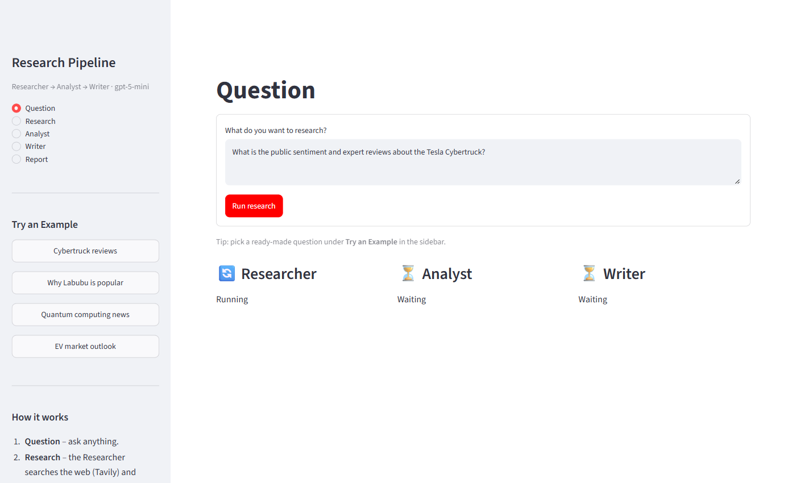
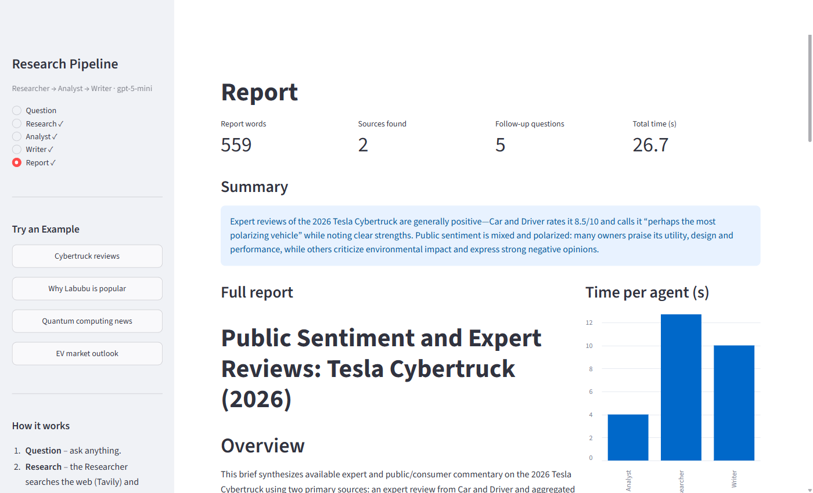

# Multi-Agent Research Pipeline

An automated research pipeline built with the [OpenAI Agents SDK](https://openai.github.io/openai-agents-python/). Ask any question and three specialized agents take it from there:

| Agent | Tools | Job | Output |
|-------|-------|-----|--------|
| **Researcher** | `tavily_search` (live web search) | Collects up to 5 sourced facts | `ResearchOutput` |
| **Analyst** | none | Extracts trends, risks and insights (2 paragraphs) | `ResearchOutput` |
| **Writer** | none | Writes an executive report | `ReportOutput` (short summary, 500+ word markdown report, 3-5 follow-up questions) |

All agents use `gpt-5-mini`, pass Pydantic models between each other, and share one in-memory `SQLiteSession`.

```
question -> Researcher -> Analyst -> Writer -> report
```

## Screenshots

**Question page**: type a question or pick an example; live status cards show each agent working.



**Report page**: summary, full report, time per agent, follow-up questions, sources and a markdown download.



**Research page**: the Researcher's sourced facts. The Analyst and Writer pages work the same way.


## Files

| File | Purpose |
|------|---------|
| `research_agents.py` | Shared code: Tavily tool, Pydantic models, the three agents, pipeline functions |
| `multi_agent_workflows.ipynb` | Notebook that tests the tool, each agent and the full pipeline |
| `multi_agent_app.py` | Streamlit UI (Question, Research, Analyst, Writer, Report pages) |
| `requirements.txt` | Python dependencies |

## Setup

Requires Python 3.10+ (developed on 3.13).

```bash
python -m venv venv
venv\Scripts\activate          # Windows  (macOS/Linux: source venv/bin/activate)
pip install -r requirements.txt
```

Create a `.env` file in the project root:

```
OPENAI_API_KEY=your-openai-api-key
TAVILY_API_KEY=your-tavily-api-key
```

Get a Tavily key at [tavily.com](https://tavily.com). `.env` is git-ignored.

## Run the Streamlit app

```bash
streamlit run multi_agent_app.py
```

Open http://localhost:8501. Use the sidebar to pick an example question or follow the pages in order. When the run finishes you land on the **Report** page, where you can download the report as markdown.

## Run the notebook

Open `multi_agent_workflows.ipynb` in VS Code and select the `venv` kernel, then run the cells from the top. The last cell runs the full pipeline and displays the summary, report and follow-up questions.

## Use it from Python

```python
from research_agents import run_pipeline

result = run_pipeline("What is the public sentiment about the Tesla Cybertruck?")
print(result["report"].short_summary)
```

## Notes

- Each run makes live web searches and three model calls, so it takes roughly 30-60 seconds and results vary between runs.
- To change an agent's instructions or the model, edit `research_agents.py`. The notebook and the app both use it.
