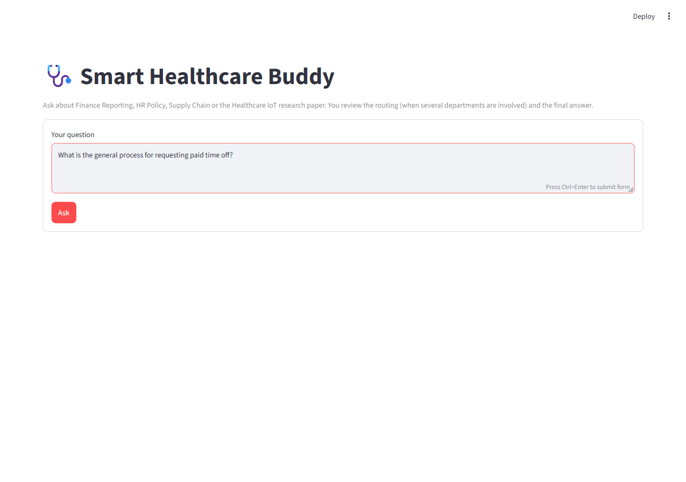
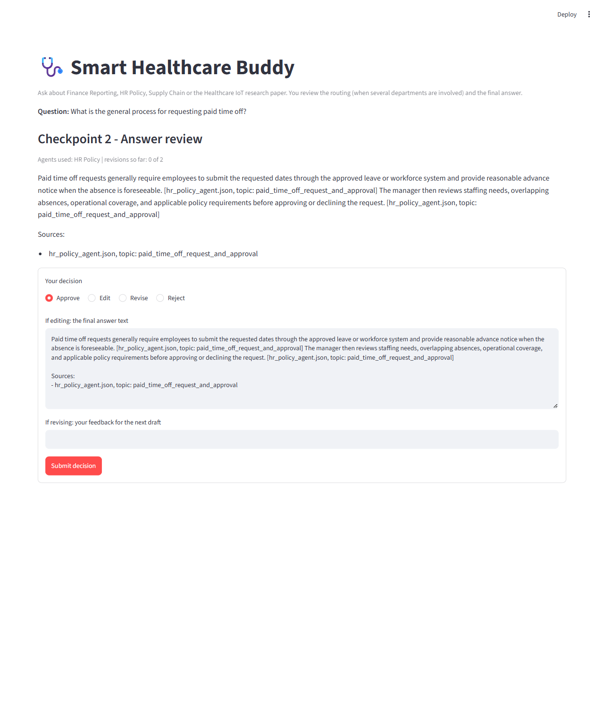
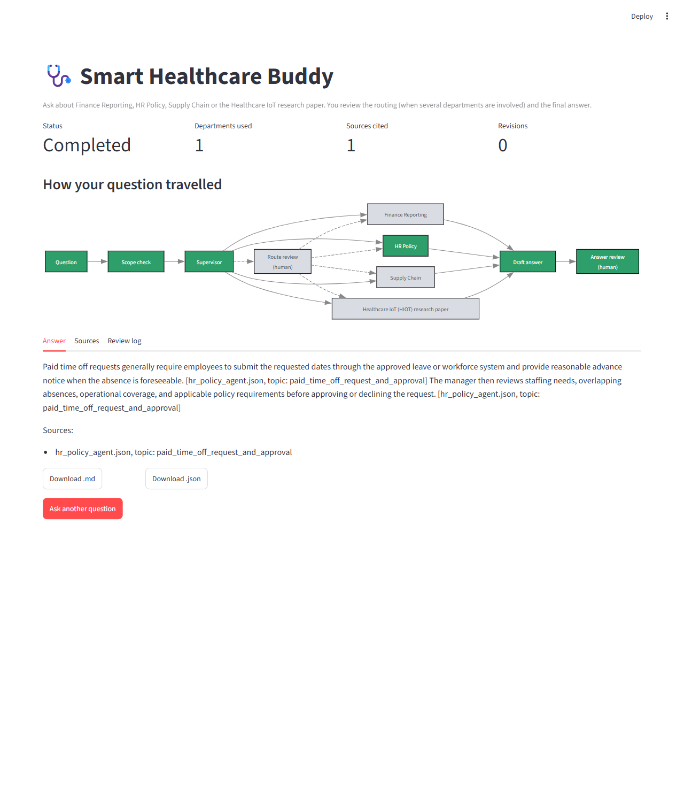
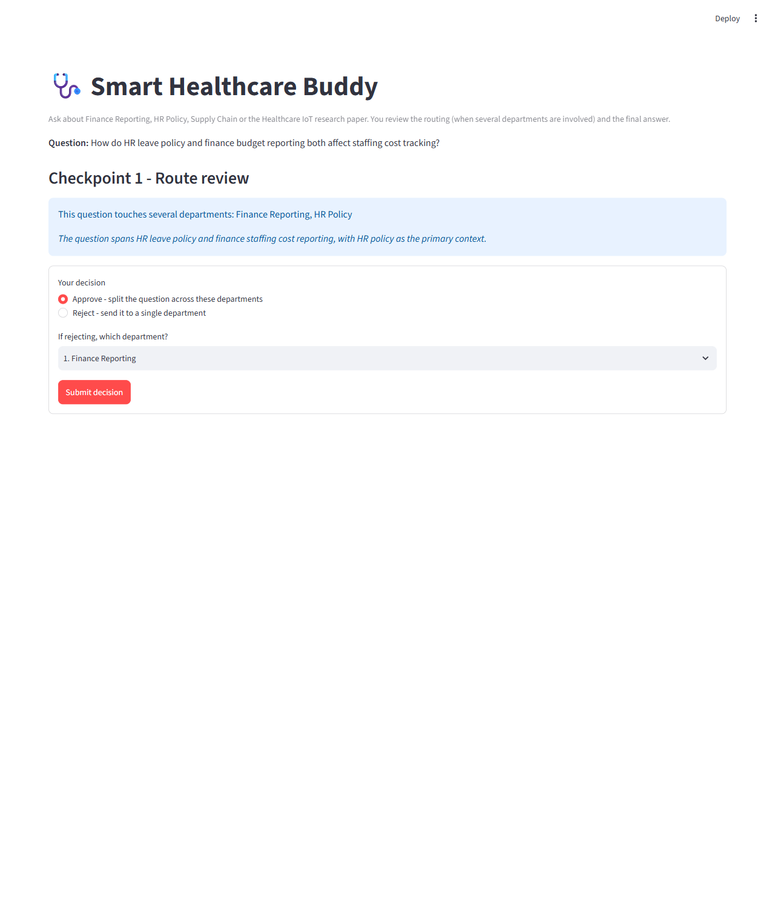
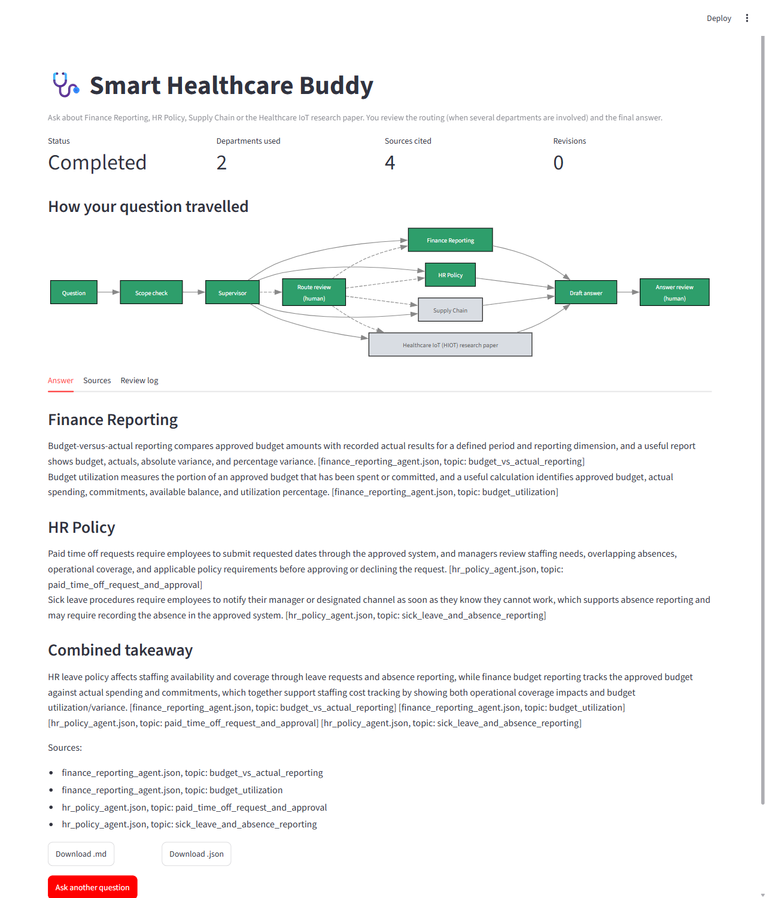

# Smart Healthcare Buddy — starter folder

Everything Claude Code needs to begin is already here: your data, the credentials file,
the package list, and the rules and guard that keep `.env` private.

## Start in 4 moves

1. Open this folder in VS Code (File → Open Folder).
2. Open `.env` in the editor and fill in your OpenAI values **yourself**.
3. Open a terminal and type `claude`.
4. Follow the build prompts document, prompt by prompt, in order.

Claude Code writes everything else: `src/`, `scripts/`, `tests/`, the vector store and the README of the finished system.

## What is here

| File or folder | Purpose |
|---|---|
| `Data/` | The four sources: three JSON datasets and the Healthcare IoT PDF |
| `.env` | Your credentials. Claude Code is blocked from reading it |
| `.env.example` | The variable names only, no values |
| `CLAUDE.md` | Project rules. Claude Code reads this automatically |
| `.claude/settings.json` | Deny rules for `.env` and registration of the guard hook |
| `.claude/hooks/block_env.py` | Blocks any action that would touch `.env` |
| `requirements.txt` | The pinned packages |
| `.gitignore` | Keeps `.env`, `.venv`, `chroma_db` and outputs out of git |

**Do not edit or delete `CLAUDE.md`, `.claude/settings.json` or the hook.** They are the credential guard.

## Screenshots

Run with `streamlit run streamlit_app.py`.

| Step | Screenshot |
|---|---|
| 1. Ask a question |  |
| 2. Checkpoint 2 - answer review |  |
| 3. Result, one department |  |
| 4. Checkpoint 1 - route review (several departments) |  |
| 5. Result, two departments |  |
